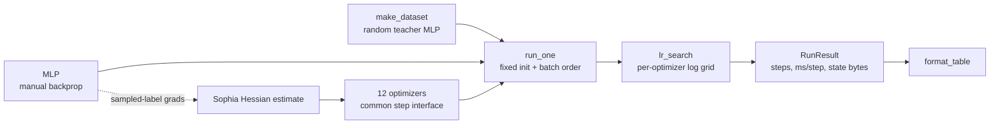

# Optimizer Zoo Benchmark

Twelve neural-network optimizers implemented from scratch in NumPy and run through one benchmark that reports the three numbers that actually decide whether an optimizer is worth switching to: **steps to a target loss**, **wall-clock per step**, and **optimizer-state memory**.

The point of the project is the tradeoff the table makes visible. An optimizer can reduce the number of training steps and still make the run slower, because every update has its own compute and memory cost. If a candidate reaches the target in 20% fewer steps but makes each step 30% slower, it takes about 4% *longer* overall (80 x 1.3 s = 104 s versus 100 x 1.0 s). The benchmark keeps data, model, initialisation and minibatch order identical for every optimizer, gives each one a learning-rate search, and prints both the step count and the time so you cannot be fooled by either number alone.

## The twelve optimizers

| Family | Optimizer | What it stores | What it does to the gradient |
|---|---|---|---|
| Smoothing / adaptive steps | SGD+momentum | 1 buffer (velocity) | Running accumulation of gradients; persistent directions build up, inconsistent ones cancel |
| | AdaGrad | 1 buffer (sum of g^2) | Per-parameter step sizes from an ever-growing sum, so steps shrink toward zero |
| | RMSprop | 1 buffer (EMA of g^2) | Same scaling but old gradients fade |
| | Adam | 2 buffers (m, v) | Momentum plus second-moment scaling, bias-corrected |
| Regularization / memory / history | AdamW | 2 buffers | Adam with *decoupled* weight decay applied to the weights directly |
| | Adafactor | row + column stats (n+m, not n x m) | Factored second moment for matrices; update clipping |
| | Lion | 1 buffer (momentum) | Sign of a momentum/gradient blend: every coordinate moves by exactly `lr` |
| | AdEMAMix | 3 buffers (fast m, slow m, v) | Adds a very slow EMA (beta3 ~ 0.9999) so old directions survive longer |
| Matrix structure / curvature | Shampoo | momentum + L (n x n) + R (m x m) + inverse roots | Preconditions a matrix gradient from both sides: `L^-1/4 G R^-1/4` |
| | SOAP | Shampoo stats + eigenbases + Adam moments | Rotates the gradient into Shampoo's eigenbasis, runs Adam there, rotates back |
| | Muon | 1 buffer (momentum) | Orthogonalises hidden-matrix momentum with Newton-Schulz iterations; vectors, embeddings and the output layer stay on AdamW |
| | Sophia | 2 buffers (m, diagonal Hessian h) | Divides momentum by a periodically refreshed Gauss-Newton-Bartlett curvature estimate, then clips elementwise |

## Run

```bash
pip install -r requirements.txt
python -m optimizer_zoo bench              # the main table (about 10 s on a laptop CPU)
python -m optimizer_zoo bench --only AdamW,Lion,Muon --max-steps 400 --json
python -m optimizer_zoo memory --params 1e9 # analytic state memory at 1B parameters
python -m optimizer_zoo decay              # coupled L2 in Adam vs decoupled decay in AdamW
python -m optimizer_zoo tradeoff --fewer-steps 0.2 --slower-step 0.3
python -m unittest discover -s tests -v
```

Example `bench` output (seed 0, 1,990-parameter MLP, target train loss 0.35):

```
optimizer       best lr  steps->target  ms/step  time->target  state bytes  x model  final loss    acc
SGD+momentum      1e-01            100    0.414        0.041s        7,960    1.00x      0.3495  0.871
AdaGrad           1e-01             90    0.332        0.030s        7,960    1.00x      0.3387  0.880
RMSprop           1e-02             90    0.265        0.024s        7,960    1.00x      0.3411  0.875
Adam              3e-02            100    0.433        0.043s       15,920    2.00x      0.3292  0.878
AdamW             3e-02            100    0.311        0.031s       15,920    2.00x      0.3316  0.877
Adafactor         1e-02            135    0.458        0.062s          912    0.11x      0.3481  0.869
Lion              3e-03            185    0.366        0.068s        7,960    1.00x      0.3491  0.881
AdEMAMix          1e-02            110    0.479        0.053s       23,880    3.00x      0.3427  0.866
Shampoo           1e-01            100    0.637        0.064s       78,672    9.88x      0.3396  0.872
SOAP              3e-02            145    0.550        0.080s       86,352   10.85x      0.3452  0.870
Muon              3e-01             75    0.442        0.033s        9,776    1.23x      0.3273  0.879
Sophia            3e-03            145    0.375        0.054s       15,920    2.00x      0.3406  0.866
```

Read the `steps->target` and `time->target` columns together: Muon needs the fewest steps here, but each step costs more than RMSprop's, so the clock-time gap is much smaller than the step-count gap. Shampoo and SOAP hold roughly 10x the model's own size in optimizer state on this toy (their n x n and m x m statistics dominate when matrices are small), Adafactor holds about a tenth. Timings are CPU wall-clock and will vary by machine; the step counts are deterministic for a given seed.

The `memory` command does the same accounting analytically at scale: at 1B parameters Adam's two FP32 moment buffers alone are 8 GB, Adafactor's factored statistics are a few megabytes, AdEMAMix needs 12 GB, and Shampoo/SOAP need 20-24 GB with 4096 x 4096 matrices.

## How it works



Every optimizer implements `step(params, grads, aux)` and updates the parameter dict in place. `aux` carries the one thing a plain gradient cannot provide: a closure that returns gradients against labels sampled from the model's own softmax, which Sophia uses for its Gauss-Newton-Bartlett diagonal Hessian estimate. Optimizer state lives in per-parameter dicts of NumPy arrays, so `state_bytes()` is an exact measurement rather than an estimate.

Matrix-aware optimizers treat 1-D parameters differently, as the published methods do: Shampoo and SOAP fall back to Adam for vectors, and Muon applies only to hidden weight matrices (by default every 2-D parameter except the last) while AdamW handles biases and the output layer. Learning-rate grids are per family because the update scale differs: Lion's sign update and Muon's orthogonalised update are not comparable to AdamW at the same learning rate, and copying AdamW's learning rate into them is not a fair comparison.

## Code map

| File | Responsibility |
|---|---|
| `optimizer_zoo/model.py` | Synthetic dataset from a random teacher network; two-layer MLP with manual forward/backward; sampled-label gradients for Sophia. |
| `optimizer_zoo/optimizers.py` | The twelve optimizers behind one `Optimizer` interface, plus `newton_schulz` and the `Aux` carrier. Grouped into the three families above. |
| `optimizer_zoo/benchmark.py` | Fixed-protocol training runs, learning-rate search, `RunResult` records, `effective_time` arithmetic and the results table. |
| `optimizer_zoo/memory_report.py` | Analytic optimizer-state memory at any parameter count (the 8 GB-at-1B style numbers). |
| `optimizer_zoo/__main__.py` | CLI with `bench`, `memory`, `decay` and `tradeoff` subcommands. |
| `tests/test_optimizers.py` | Every optimizer descends on a quadratic; state sizes (Adam 2x, Lion 1x, Adafactor n+m, Shampoo/SOAP square stats); Lion's constant-magnitude update; AdamW decay independent of gradient scale while coupled L2 is not; Newton-Schulz orthogonalisation; Muon's parameter split; Sophia clipping; deterministic benchmark. |
| `requirements.txt` | NumPy only. |

## Choosing on your own workload

Use AdamW as the reference run, then test alternatives against a specific constraint rather than in general. Under memory pressure, try Adafactor or Lion. For matrix parameters, evaluate Muon, Shampoo or SOAP and account for which parameters they cover and what the preconditioner refresh costs. Give every candidate its own learning-rate search, keep the data, model and evaluation protocol fixed, and report validation quality at a fixed compute budget *and* time to a target quality, along with peak memory and step time. The useful result is a reproducible improvement under your training constraints, including the cost of tuning it.

## Limits

- The implementations are faithful to the published update rules but written for readability, not speed. Shampoo and SOAP refresh their eigendecompositions every 10 steps; the real implementations use blocked preconditioners, lower-precision roots and asynchronous refreshes.
- The benchmark model is tiny, so per-step timings are dominated by Python overhead, and the Shampoo/SOAP state ratios are inflated relative to large models (a 4096 x 4096 matrix makes the square statistics only 2x the parameter count).
- Sophia's Hessian estimate uses the sampled-label (Gauss-Newton-Bartlett) estimator; the Hutchinson variant is not implemented.
- No learning-rate schedules, gradient clipping or mixed precision are applied, so absolute step counts are not representative of production training.

## References

- [Adam](https://arxiv.org/abs/1412.6980), [AdamW](https://arxiv.org/abs/1711.05101), [Adafactor](https://arxiv.org/abs/1804.04235)
- [Lion](https://arxiv.org/abs/2302.06675), [AdEMAMix](https://arxiv.org/abs/2409.03137)
- [Shampoo](https://arxiv.org/abs/1802.09568), [SOAP](https://arxiv.org/abs/2409.11321), [Sophia](https://arxiv.org/abs/2305.14342)
- [Muon reference implementation](https://github.com/KellerJordan/Muon)
